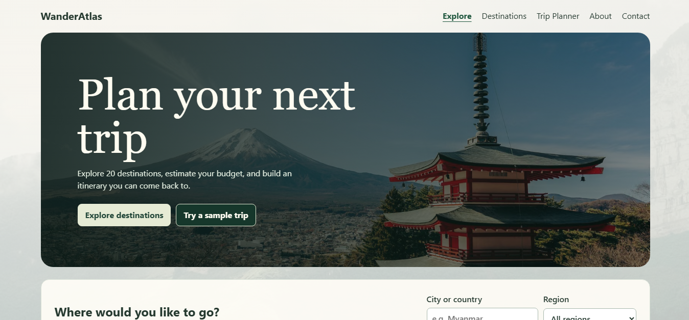
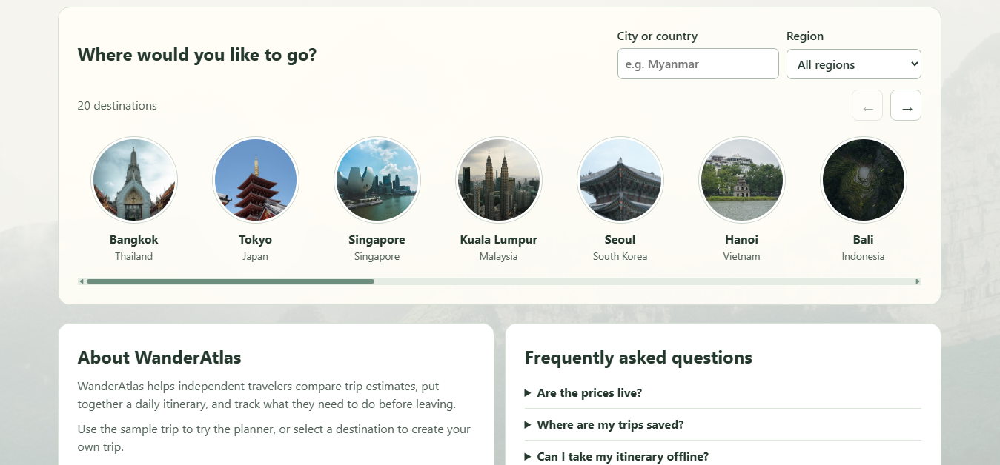
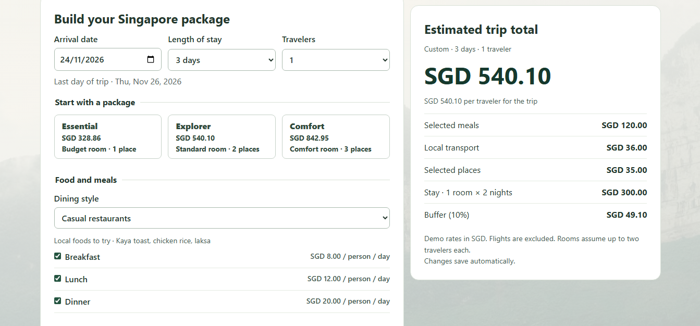
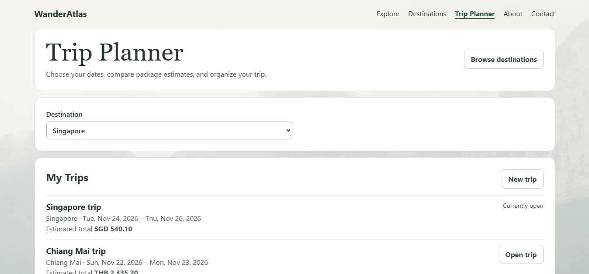
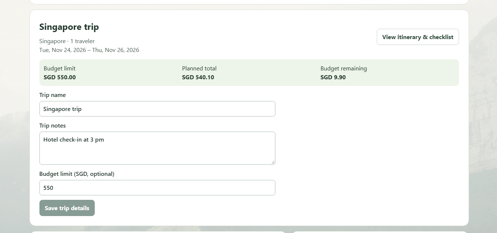
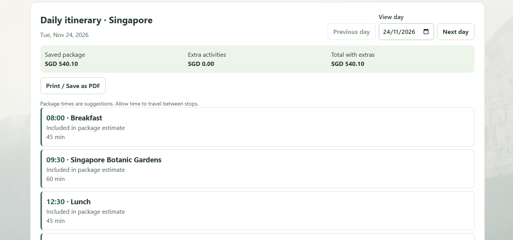
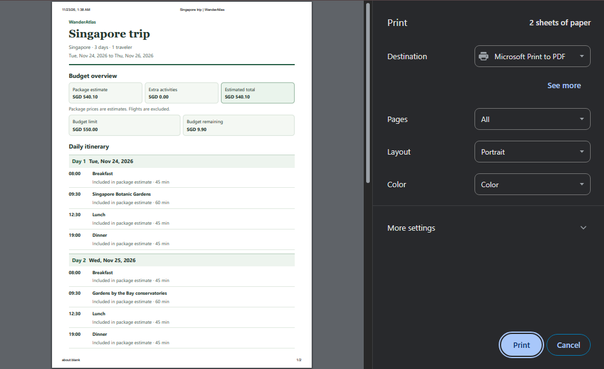

# [WanderAtlas – Trip Planner](https://github.com/Ei359/WanderAtlas-Trip-Planner)

WanderAtlas is a travel planning application I built with React. It lets you explore destinations, estimate trip costs, and organize each day of your trip in one place.

I built it around the steps I would take when planning a trip. I can choose where to go, work out how much to budget, and save a plan that I can come back to later.

<!-- Add your WanderAtlas Vercel demo link here. -->
## Trip Planner Preview

### 1. WanderAtlas Home

Start by exploring destinations or open a sample trip to see what a finished plan looks like.



### 2. Explore Destinations

Browse 20 destinations, search by city or country, or filter by region. Selecting a destination opens it in the planner.

 

### 3. Build a Package and Estimate Costs

Enter your arrival date, length of stay, and number of travelers. Compare the Essential, Explorer, and Comfort packages, then adjust your choices to see an updated cost breakdown. The estimate includes selected meals, local transport, attractions, accommodation, and a budget buffer.



### 4. Save and Reopen Plans in My Trips

Keep multiple plans in one place. The list shows each trip's dates and estimated total so you can find the plan you want to reopen.



### 5. Add Trip Notes and Set a Budget Limit

Give your trip a name, add notes such as your hotel check-in time, and compare the planned total with a budget limit. In this Singapore example, the estimated cost is SGD 540.10, leaving SGD 9.90 from a budget of SGD 550.



### 6. View the Daily Itinerary

Switch between days to see suggested activities, start times, and durations. The summary shows the saved package cost and any extra activities you add.



### 7. Print or Save as PDF

Use **Print / Save as PDF** to keep a copy of the trip. The print view includes the budget overview and a day-by-day itinerary in one document.



## Features

### 1. Destination Discovery

- Browse 20 destinations, including Bagan, Bangkok, Tokyo, and Paris.
- Search for a city or country and filter destinations by region.
- Select a destination to open it in the trip planner.
- Open the sample Bagan trip to explore how an itinerary works.

### 2. Trip Packages and Budgeting

- Set the arrival date, length of stay, and number of travelers.
- Compare three package presets: Essential, Explorer, and Comfort.
- Customize meals, accommodation, and attractions.
- See a cost breakdown and update the estimate as you change your choices.
- Set a budget limit and check how much is left or how far the plan goes over it.

### 3. Saved Trips

- Save multiple plans in **My Trips**, including separate plans for the same destination.
- Reopen saved plans and continue editing them.
- Save package changes automatically after saving the trip for the first time.
- Give each trip a name and add notes such as hotel check-in times.

### 4. Itinerary and Checklist

- View a suggested schedule for each day of the trip.
- Add activities with a start time, duration, and estimated cost.
- See a warning when activities overlap or leave too little travel time.
- Use the checklist to track tasks like booking tickets and saving confirmations.
- Print the itinerary or save it as a PDF to keep a copy.

## Technologies Used

| Technology | How I used it |
| --- | --- |
| React | Building the Explore page, planner, budget summary, and itinerary |
| JavaScript | Calculating costs, building schedules, and managing trip data |
| HTML and CSS | Structuring the interface and adapting it to smaller screens |
| Vite | Running the development server and building the app |
| Browser local storage | Saving trips, notes, and checklist progress |
| Git and GitHub | Tracking changes and sharing the project |

## Getting Started

### Requirements

- Node.js and npm
- Git if you want to clone the repository

### Installation

1. On the GitHub repository page, click **Code** and copy the HTTPS URL. In your terminal, run `git clone` followed by that URL.
2. Open the downloaded WanderAtlas folder in VS Code.
3. Open the terminal in the folder that contains `package.json` and run:

   ```bash
   npm install
   npm run dev
   ```

4. Open the local URL printed in the terminal.

## Try the Planner

1. Open **Explore** and choose a destination.
2. Enter your arrival date, trip length, and number of travelers.
3. Choose a package and review the cost breakdown.
4. Click **Save as new trip**.
5. Open **My Trips** to find your saved plan, then select **View itinerary & checklist**.
6. Add an activity or use **Print / Save as PDF** to keep a copy of the itinerary.

Use **Save trip details** after changing the trip name, notes, or budget limit.

## Building the Project

To create a production build, run:

```bash
npm run build
```

## Data Storage and Estimates

WanderAtlas stores trips in your browser. To reopen one, use the same browser profile and site address where you saved it.

Package prices are estimates for planning and exclude flights. Actual costs can vary by date and provider.

## What I Plan to Improve

- Sync saved trips across devices.
- Add a shareable itinerary link for traveling with friends or family.
- Make it easier to compare two plans for the same destination.

## About This Project

I built WanderAtlas to practice turning a multi-step workflow into a React application. The most interesting part was connecting the package choices to the budget and itinerary so that a change in one place updates the rest of the plan.